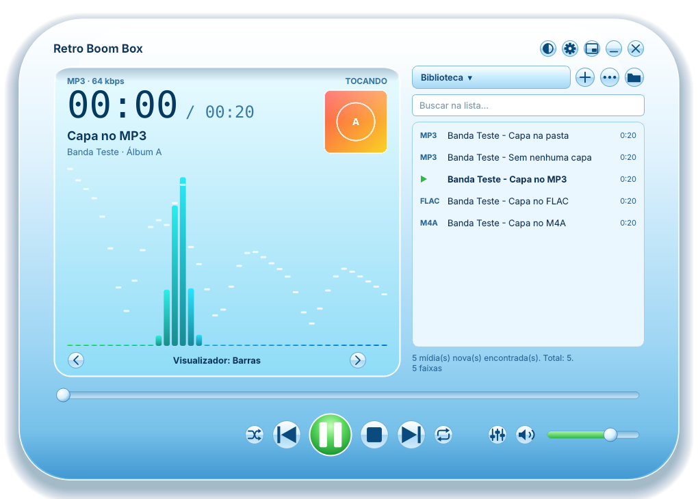
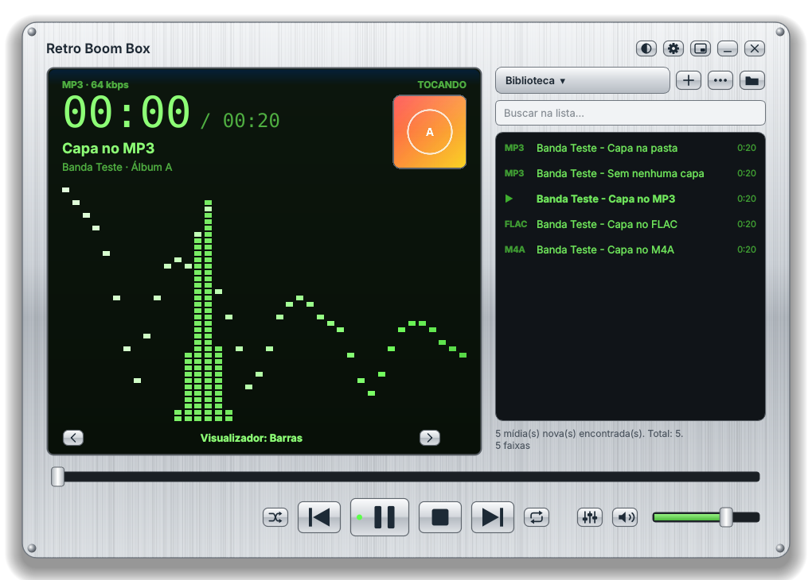
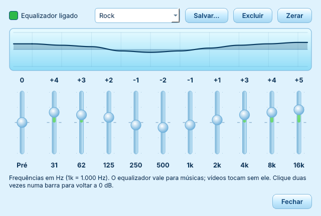

# Retro Boom Box

Um player de músicas e vídeos com a cara dos anos 90 e 2000. O visual muda por **skins**
(já vêm Frutiger Aero e Metal escovado) e os visualizadores podem ser expandidos com **pacotes**.
Feito em Python com PySide6 (Qt). Inspirado no estilo do Windows Media Player e do Winamp,
com arte original.




## O que tem

- Toca músicas (mp3, flac, wav, ogg, opus, m4a, aac, wma, aiff, mka) e vídeos (mp4, mkv, avi, mov, wmv, webm e outros)
- Biblioteca com pastas escaneadas, playlists (importar e exportar M3U), arrastar e soltar
- 8 visualizadores que reagem ao som de verdade, mais pacotes de visualizadores (`.rbbviz`)
- Skins que mudam o visual inteiro, até o formato da janela (`.rbbskin`)
- Capa do álbum, equalizador de 10 faixas com presets, modo mini
- Aviso de versão nova (procura em [Releases](../../releases), sem baixar nada sozinho)




## Como usar

**Instalado (Windows):** baixe o `RetroBoomBox-Instalador-<versão>.exe` na página de
[Releases](../../releases) e dê dois cliques.

**Direto da pasta, com Python (3.10 a 3.13):** dê dois cliques em `iniciar.bat`.
Na primeira vez ele baixa o que precisa.

**Gerar o instalador:** dê dois cliques em `criar-instalador.bat` (precisa de Python e internet;
o [Inno Setup 6](https://jrsoftware.org/isdl.php) é opcional, só para o arquivo Setup único).

## Documentação (em português)

| Arquivo | Para quê |
| --- | --- |
| `LEIAME.txt` | Como usar o programa, atalhos e formatos |
| `GUIA-DE-SKINS.txt` | Como criar skins e pacotes de visualizadores |
| `ATUALIZACOES.txt` | Como publicar versões novas e como funciona o aviso de atualização |
| `exemplos/` | 3 skins e 1 visualizador prontos para instalar e servir de modelo |

## Segurança dos pacotes

Skins são só imagens e configuração. Pacotes de visualizadores (`.rbbviz`) são pequenos
programas em Python, por isso ficam desligados até a pessoa ativá-los em
Configurações > Skins e pacotes. Ative só os de quem você confia.

## Estrutura

```
app/            o programa (main.py é o ponto de partida)
app/builtin_skins/   as skins que já vêm no programa
exemplos/       skins e visualizador de exemplo
RetroBoomBox.spec, instalador.iss, criar-instalador.bat   montagem do .exe e do instalador
```
