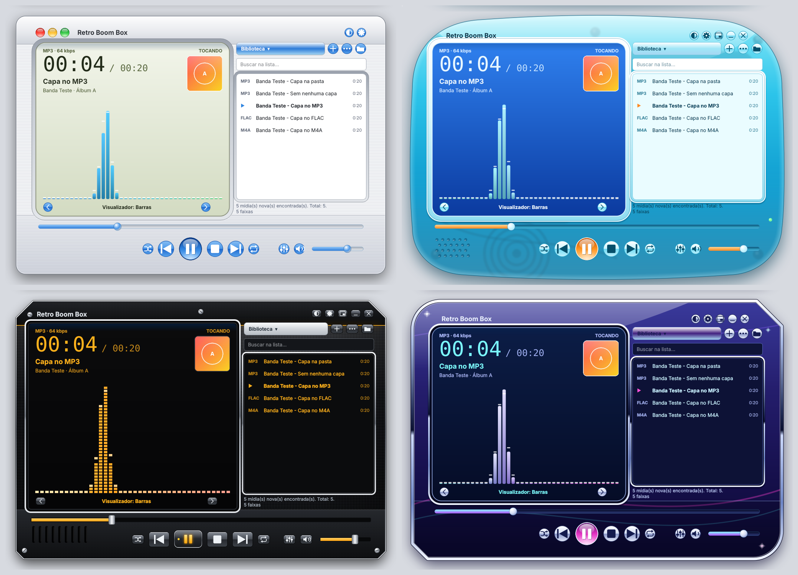
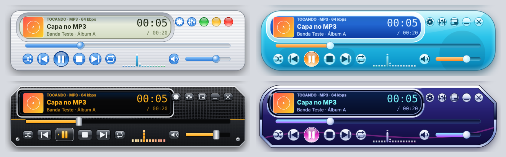
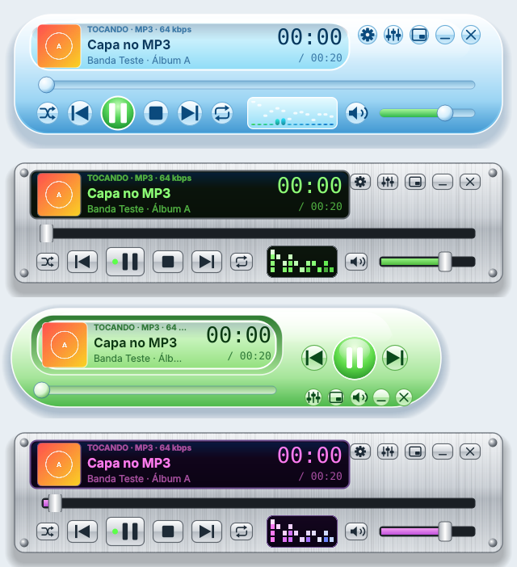

# Retro Boom Box

Um player de músicas e vídeos com a cara dos anos 90 e 2000. O visual muda por **skins**
(já vêm seis: Frutiger Aero, Metal escovado, Gota Aqua, Bolha Translúcida, Carbono Hi-Fi e Futuro 2000) e os visualizadores podem ser expandidos com **pacotes**.
Feito em Python com PySide6 (Qt). Inspirado no estilo do Windows Media Player e do Winamp,
com arte original.


As quatro skins mais novas, inspiradas nos anos 2000 (gel Aqua, plástico translúcido, fibra de carbono com visor âmbar e cromo neon):




## O que tem

- Toca músicas (mp3, flac, wav, ogg, opus, m4a, aac, wma, aiff, mka) e vídeos (mp4, mkv, avi, mov, wmv, webm e outros)
- Biblioteca com pastas escaneadas, playlists (importar e exportar M3U), arrastar e soltar
- 8 visualizadores que reagem ao som de verdade, mais pacotes de visualizadores (`.rbbviz`)
- Seis skins que já vêm no programa e suporte a skins de outras pessoas, que mudam o visual inteiro, até o formato da janela (`.rbbskin`)
- Capa do álbum, equalizador de 10 faixas com presets, modo mini
- Aviso de versão nova (procura em [Releases](../../releases), sem baixar nada sozinho)




## Como usar

**Instalado (Windows):** baixe o `RetroBoomBox-Instalador-<versão>.exe` na página de
[Releases](../../releases) e dê dois cliques.

**Direto da pasta, com Python (3.10 a 3.13):** dê dois cliques em `iniciar.bat`.
Na primeira vez ele baixa o que precisa.

**Gerar o instalador:** dê dois cliques em `criar-instalador.bat` (precisa de Python e internet;
o [Inno Setup 6](https://jrsoftware.org/isdl.php) é opcional, só para o arquivo Setup único).

## Documentação (em português)

| Arquivo | Para quê |
| --- | --- |
| `LEIAME.txt` | Como usar o programa, atalhos e formatos |
| `GUIA-DE-SKINS.txt` | Como criar skins e pacotes de visualizadores |
| `ATUALIZACOES.txt` | Como publicar versões novas e como funciona o aviso de atualização |
| `ESTILOS-ANOS-2000.txt` | O que tornava as interfaces dos anos 2000 marcantes e as 4 skins de exemplo inspiradas nelas |
| `exemplos/` | 7 skins (3 cápsulas e 4 dos anos 2000) e 1 visualizador prontos para instalar e servir de modelo |

## Licença

O código e a arte do programa usam a licença **[PolyForm Noncommercial 1.0.0](LICENSE)**.
O texto oficial é o do arquivo [`LICENSE`](LICENSE), em inglês. O resumo abaixo é só para ajudar
(não é aconselhamento jurídico).

| Pode | Deve | Não pode |
| --- | --- | --- |
| Usar, estudar e modificar o programa. Passar cópias, com ou sem modificações, para outras pessoas de graça. Usar em casa, em estudos e em projetos sem fins lucrativos. | Manter o arquivo `LICENSE` e a linha `Required Notice`, que aponta para este repositório, em toda cópia que passar adiante. | Vender o programa ou versões modificadas, cobrar pela distribuição ou usar o programa em uma empresa com fins comerciais. |

Em resumo: quem fizer uma versão própria precisa continuar citando este projeto original
(<https://github.com/The-BitLab-Team/retro_boom_box>) e não pode vender o resultado.
Quem quiser uma condição diferente (por exemplo, uso comercial) deve combinar com os autores.
Skins e pacotes feitos por outras pessoas continuam sendo obra de quem os fez.

## Segurança dos pacotes

Skins são só imagens e configuração. Pacotes de visualizadores (`.rbbviz`) são pequenos
programas em Python, por isso ficam desligados até a pessoa ativá-los em
Configurações > Skins e pacotes. Ative só os de quem você confia.

## Estrutura

```
app/            o programa (main.py é o ponto de partida)
app/builtin_skins/   as skins que já vêm no programa
exemplos/       skins e visualizador de exemplo
RetroBoomBox.spec, instalador.iss, criar-instalador.bat   montagem do .exe e do instalador
```
